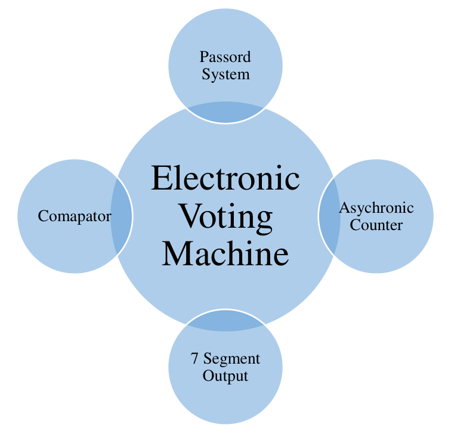
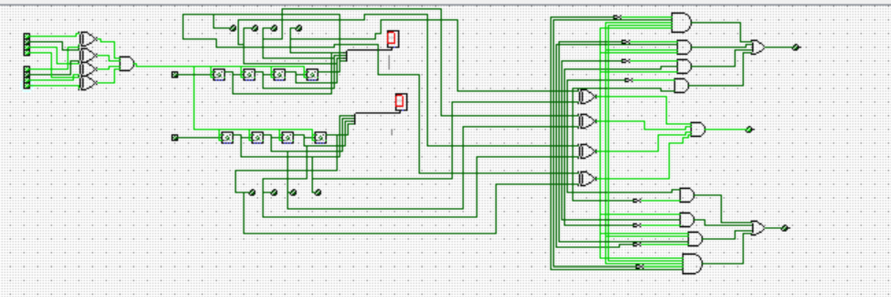
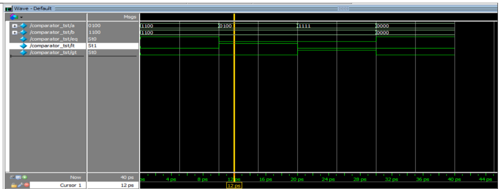
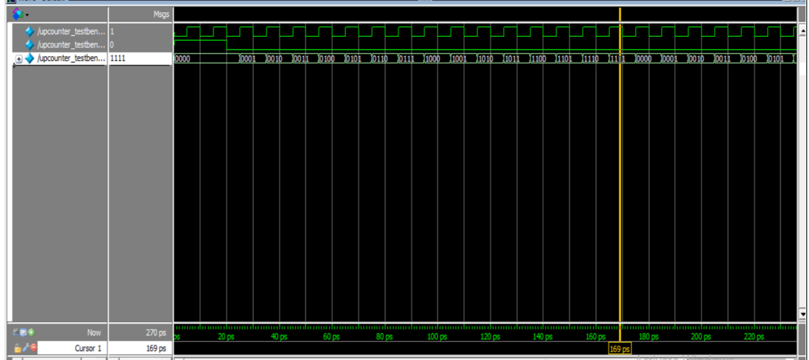
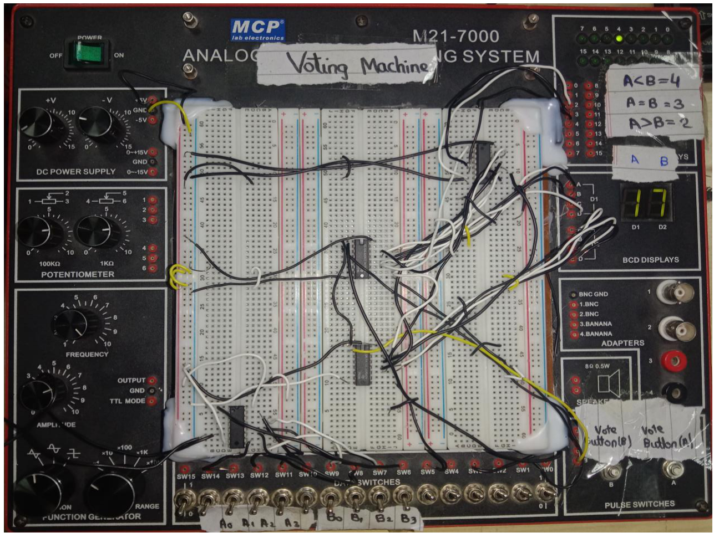

# Electronic Voting Machine Using Digital Logic Design

**Digital Logic Design Project**  
Department of Electrical Engineering  
Namal University, Mianwali, Pakistan

## Project Overview

This project implements a two-candidate electronic voting machine using digital logic circuits.

The system includes password verification, two 4-bit vote counters, and a 4-bit comparator to determine the candidate with more votes.

The circuit was designed and simulated using Logisim. The counters and comparator were implemented in Verilog HDL and tested using testbenches. The project also included a hardware implementation.

## System Block Diagram

## Main Components

### 1. Password Verification

The security system uses eight input buttons. Four represent the stored password and four represent the entered password.

XNOR and AND gates compare the two inputs. Voting is enabled only when the passwords match.

### 2. Vote Counting

Two 4-bit up counters count the votes for two candidates.

The vote counts are displayed using 7-segment displays.

### 3. Vote Comparison

A 4-bit comparator compares the vote counts and determines which candidate has received more votes.

## Tools and Technologies

- Digital Logic Design
- Logisim
- Verilog HDL
- Logic gates
- 4-bit counters
- 4-bit comparator
- 7-segment displays

## Verilog Source Code

- [4-Bit Comparator](comparator.v.v)
- [4-Bit Up Counter](up_counter.v.v)

## Verilog Testbenches

- [Comparator Testbench](comparator_tb.v.v)
- [Up Counter Testbench](up_counter_tb.v.v)

## Project Documentation

- [Complete Project Report](EVM_Project_Report.pdf.pdf)
- [Simulation Results](EVM_Simulation_Results.pdf.pdf)

## Circuit Design and Simulation

### Logisim Circuit

### Comparator Simulation

### Counter Simulation

## Hardware Implementation

The circuit was also implemented and tested using physical hardware.

## Project Results

The project demonstrates the following operations:

- Password verification using XNOR and AND gates.
- Vote counting for two candidates using 4-bit counters.
- Vote display using 7-segment displays.
- Comparison of vote counts using a 4-bit comparator.
- Simulation of the counter and comparator in Verilog.
- Hardware implementation of the electronic voting machine.

Detailed results and simulation waveforms are available in the project documentation.

## Institution

**Namal University, Mianwali, Pakistan**  
Department of Electrical Engineering
